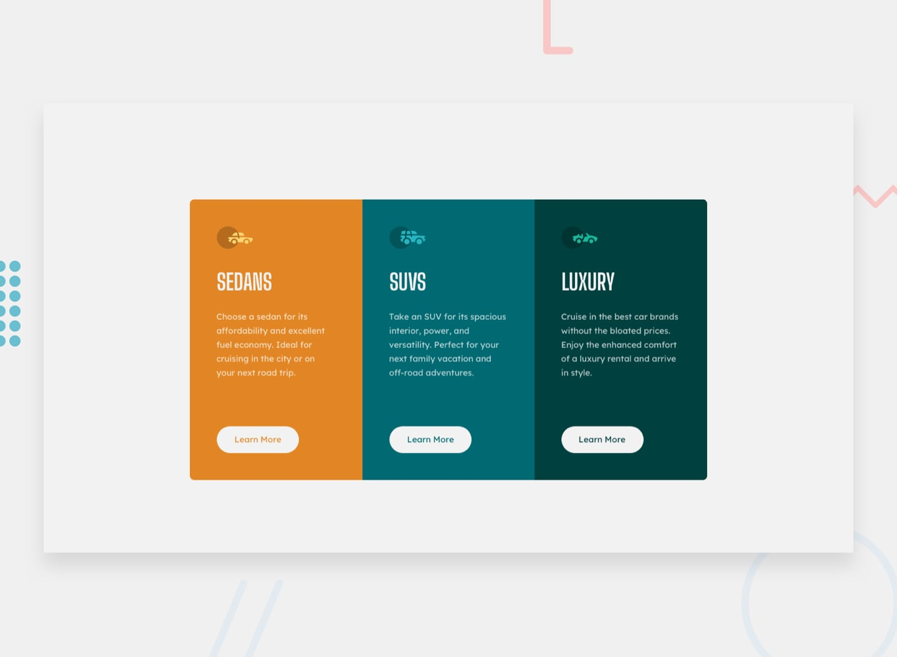

# Componente de Cards com Três Colunas

Projeto desenvolvido como parte de um desafio da plataforma [Frontend Mentor](https://www.frontendmentor.io/), com o objetivo de reproduzir um componente de apresentação de três categorias de veículos: Sedans, SUVs e Luxury.

O projeto foi desenvolvido utilizando HTML e CSS, com foco em estrutura semântica, Flexbox, responsividade e reutilização de estilos.

## 📸 Prévia do projeto

## 🛠️ Tecnologias utilizadas

- HTML5
- CSS3 Flexbox
- Variáveis CSS)
- Google Fonts

## 🚀 Desenvolvimento futuro

Pretendo continuar aprimorando meus conhecimentos em HTML e CSS por meio de novos desafios, dando atenção especial à responsividade, acessibilidade, organização e reutilização de código.

## 👨‍💻 Autor

- GitHub: [@Dev-jaoo](https://github.com/Dev-jaoo)
- Frontend Mentor: [@Dev-jaoo](https://www.frontendmentor.io/profile/Dev-jaoo)

## 🙏 Agradecimentos

Agradeço à plataforma [Frontend Mentor](https://www.frontendmentor.io/) pela oportunidade de praticar desenvolvimento front-end com desafios baseados em projetos reais.